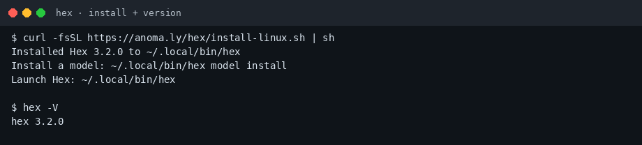
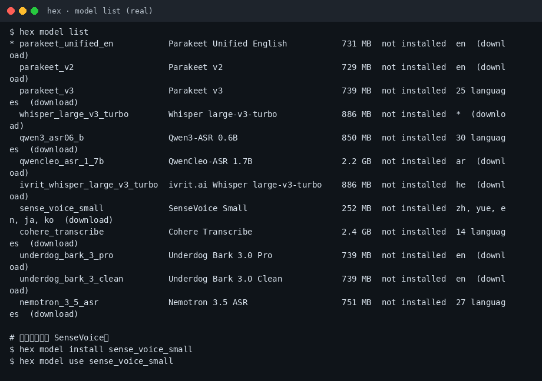
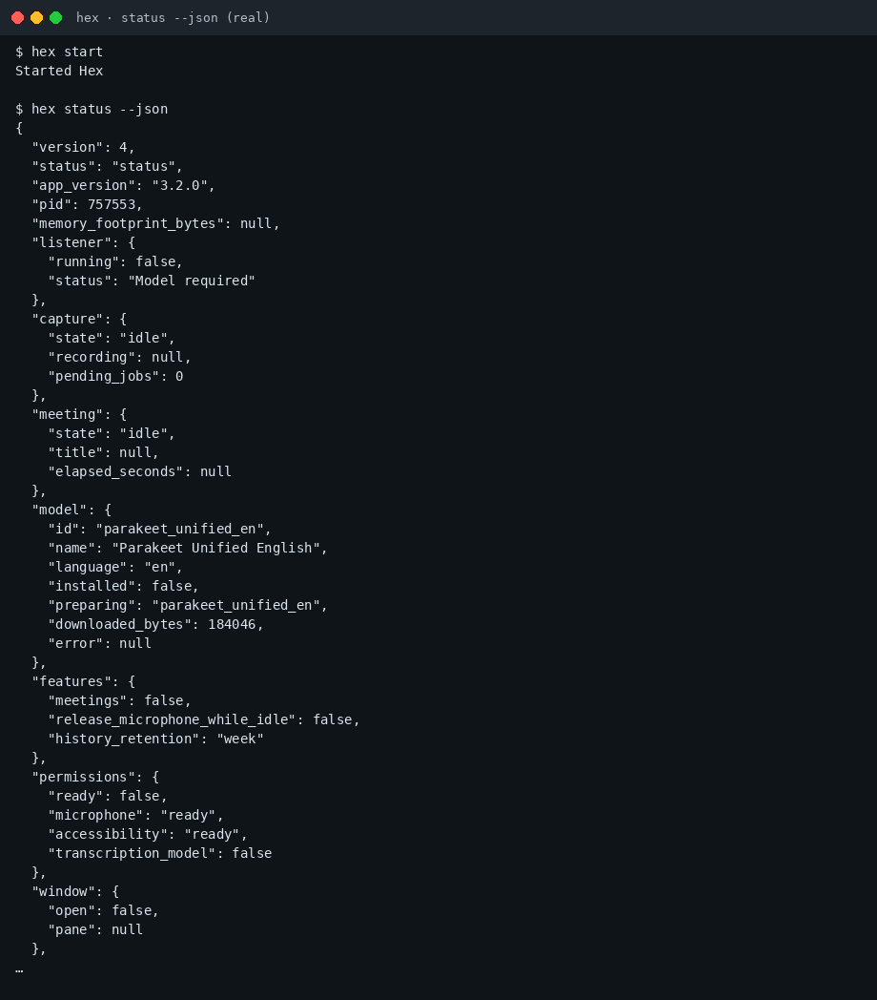

# Hex 小白中文教程

> 本地语音听写：按住快捷键说话，松开后把文字粘贴到当前输入框（社区非官方教程）  
> 上游：[`anomalyco/hex`](https://github.com/anomalyco/hex) · 官网：[anoma.ly/hex](https://anoma.ly/hex)  
> 教程校对：2026-11-02（Asia/Shanghai）· 本机实测 **hex 3.2.0**（linux_amd64）

[](https://github.com/xianyu110/awesome-hex-zh)
[](https://github.com/anomalyco/hex)
[](LICENSE)
[](https://xianyu110.github.io/awesome-hex-zh/)

---

## 截图索引

| # | 文件 | 类型 | 说明 |
|---|------|------|------|
| 1 | [`images/01-install.png`](images/01-install.png) | **真实** | 官方 install-linux.sh 安装到 `~/.local/bin/hex`，`hex -V` → 3.2.0 |
| 2 | [`images/02-model-list.png`](images/02-model-list.png) | **真实** | `hex model list`：含 `sense_voice_small`（zh/yue/en/ja/ko） |
| 3 | [`images/03-status.png`](images/03-status.png) | **真实** | `hex start` 后 `hex status --json`（模型下载中；路径已脱敏） |

> 真实截图在 Linux x86_64 沙盒采集。界面听写演示需本机麦克风；本教程未录制语音波形。

---

## 这是什么？

**Hex** 是跨平台（macOS / Windows / Linux）的**本地语音听写**工具：按住快捷键说话，松开后在本机转录，并把文字粘贴到当前焦点应用。首次运行会下载语音模型；之后转录默认不上传云端。

本仓库只提供**中文小白教程**（MIT），不二次分发上游二进制。上游许可证为 **MIT**。

---

## 官方链接（请以官方为准）

| 资源 | 链接 |
|------|------|
| 源码 | https://github.com/anomalyco/hex |
| 官网 / 下载 | https://anoma.ly/hex |
| Linux 说明 | 上游 `docs/linux.md`（见仓库 `docs/`） |
| 功能地图 | 上游 `docs/features/README.md` |

---

## 环境要求（摘要）

- **macOS**：官网标明 Apple Silicon + 较新 macOS（Homebrew cask：`brew install --cask anomalyco/tap/hex`）
- **Windows**：官网安装器（x64 / ARM64）
- **Linux**：x86_64 / ARM64；官方脚本或 `.deb` / `.rpm`；需要可用的图形会话与麦克风；Wayland 粘贴依赖 `wtype` 或桌面 RemoteDesktop 门户（见官方 linux 文档）
- 本教程实测：官方 `install-linux.sh` → **hex 3.2.0**

---

## 安装（macOS / Windows / Linux）

### Linux（本教程实测）

```bash
curl -fsSL https://anoma.ly/hex/install-linux.sh | sh
hex -V
# hex 3.2.0
```



可选：`HEX_INSTALL_CHANNEL=dev` 装开发通道；卸载：`sh install-linux.sh uninstall`（以你下载的脚本为准）。

### macOS

```bash
brew install --cask anomalyco/tap/hex
```

或从 [anoma.ly/hex](https://anoma.ly/hex) 下载 DMG。

### Windows

从官网下载对应架构的 Installer，按向导安装（官方文档有 SmartScreen 说明）。

---

## 中文模型（重要）

默认可能指向英文 Parakeet。中文 / 粤语听写请安装并切换 **SenseVoice Small**：

```bash
hex start
hex model list
hex model install sense_voice_small
hex model use sense_voice_small
```



也可在设置里选 Whisper / Qwen3-ASR 等多语言模型（体积更大）。**以你本机 `hex model list` 当时列出的 id 为准。**



---

## 第一次演示任务（约 5 分钟）

1. `hex start`（或直接 `hex` 打开窗口）
2. 授予麦克风权限；若要粘贴到其他应用，按系统要求授予辅助功能 / 输入相关权限
3. 确认当前模型为 `sense_voice_small`（或你选的多语言模型）
4. 打开记事本 / 浏览器输入框，按住默认快捷键说话，松开后看文字是否粘贴成功  
   - Linux 默认常见为 **Alt+Space**（以设置页 / `hex settings` 为准）  
   - macOS 常见为 **Option**；Windows 常见为 **Ctrl+Space**（以官方文档为准）
5. 可选：`hex history` 查看保留的听写记录（保留策略在设置里）

> **声音与隐私**：转录在本地完成。若启用任何「把转写结果交给云端后处理」类 Labs / 实验功能，请自行阅读官方说明并评估是否上传文本。本教程不引导克隆他人声音；若使用任何声音相关扩展，须本人授权。

---

## 常见报错与解决

| 现象 | 可能原因 | 处理 |
|------|----------|------|
| `Hex is not running` | 未启动后台进程 | 先 `hex start` 再执行 `model` / `status` 等控制命令 |
| 中文乱成英文或乱码 | 仍在用英文 Parakeet | `hex model install sense_voice_small` 并 `use` |
| 能识别但不能粘贴 | Wayland / 权限 | 按官方 linux 文档装 `wtype` 或配置门户；检查辅助功能权限 |
| 无声音 | 麦克风设备 / 权限 | `hex devices` 看 ALSA 设备；系统设置里授权麦克风 |
| 模型下载很慢 | 网络 | 换网络或稍后重试；勿把模型文件提交进本教程仓 |
| AVX2 过旧 CPU | 官方要求 | 换较新 x86_64（约 2013 年后）或看官方错误提示 |

---

## 许可证与合规

- **本教程文字与配图**：MIT（见 [LICENSE](LICENSE)）  
- **上游 Hex**：MIT  
- 不硬推未备案境外模型或 API 中转；听写优先本地模型（SenseVoice / Whisper 等）  
- 可选软链：[tryallapi.com](https://tryallapi.com/?aff=5A6A)（aff=5A6A）；店铺仅 [MaynorAI](https://wzyp.cn/shop/maynorai)

与 Anomaly / Hex 官方**无隶属关系**。功能与快捷键以官网与上游 README 为准，本教程不编造未验证的性能数字。

---

## GitHub Pages

图文镜像页：https://xianyu110.github.io/awesome-hex-zh/
